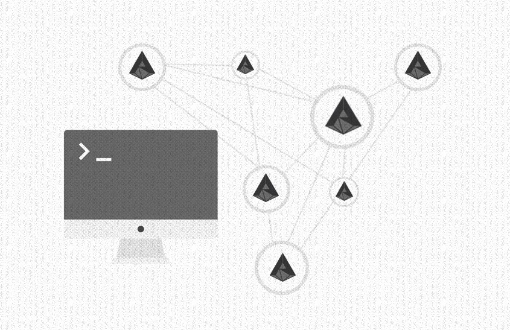

# ADAMANT

ADAMANT is a **decentralized, blockchain-based messaging platform**. Applications use ADAMANT as an anonymous, encrypted relay and storage layer for secure communication. Examples include the [Messenger app](https://github.com/Adamant-im/adamant-im), [Blockchain 2FA](https://github.com/Adamant-im/adamant-2fa), and [Exchange bot](https://github.com/Adamant-im/adamant-exchangebot).

Additional information:

- ADAMANT website: https://adamant.im
- Tor website: http://adamantim24okpwfr4wxjgsh6vtw4odoiabhsfaqaktnfqzrjrspjuid.onion
- [How decentralized blockchain messenger works](https://news.adamant.im/how-decentralized-blockchain-messenger-works-b9932834a639)
- [Encryption overview in ADAMANT Messenger](https://news.adamant.im/encryption-overview-in-adamant-messenger-878ecec1ff78)

[](http://www.gnu.org/licenses/gpl-3.0)

> Developed and maintained by the ADAMANT developer community and **cryptofoundry** as part of an open-source blockchain ecosystem developed since 2016.
> We build custom crypto software, trading bots, payment systems and blockchain infrastructure. [Tell us what to build](https://adamant.business#contact).
>



## Node and API Documentation

Comprehensive [node documentation](https://docs.adamant.im) is available.

It covers the Fair dPoS consensus algorithm, decentralization principles, node installation and configuration, and other core concepts. The documentation also describes API endpoints for managing accounts, transactions, chats, and key-value storage (KVS), along with account creation, message encryption and decryption, and API data types.

See also:

- [ADAMANT Improvement Proposals (AIPs)](https://aips.adamant.im)

### Removed Legacy Control APIs

Forging is configured only through `forging.secret`. Changing the configured
forging set requires editing the configuration and gracefully restarting the
node. The legacy `forging.access` setting is deprecated, accepted for backward
compatibility, and ignored.

The legacy forging enable, disable, and status routes, the DApp install,
launch, stop, uninstall, and server-side signing routes, and the legacy DApp
peer runtime routes are no longer available. DApp registration and in/out
transfers remain consensus-supported transaction types; clients must sign those
transactions locally and submit them through the standard transaction API.
Existing `dapp` configuration is deprecated, accepted for backward
compatibility, and ignored. This is a breaking HTTP API change and does not
change DApp transaction validation, serialization, fees, or replay behavior.

## Installing, Configuring, and Running an ADAMANT Node

ADAMANT Node requires Node.js 22.22.2 or newer on the 22.x line, or Node.js 24.15.0 or newer. The installation scripts support Node.js 22, 24, and 26, with Node.js 24 selected by default.

Refer to the [ADAMANT Node installation documentation](https://docs.adamant.im/own-node/installation.html) for hardware requirements and complete setup instructions for Linux, macOS, and Windows.

### Linux Installation Scripts

The bundled installers support:

- Ubuntu 20.04, 22.04, 24.04, and 26.04 LTS: `tools/install_node.sh`
- RHEL-compatible releases 8-10, including CentOS Stream, Rocky Linux, AlmaLinux, and RHEL: `tools/install_node_centos.sh`
- Ubuntu repair from a published blockchain image: `tools/fix_node.sh`

Ubuntu 20.04 is supported by the script, but its standard security maintenance has ended. Use Ubuntu Pro or upgrade the operating system for continued security updates.

The installers share `tools/lib/adamant_node_common.sh`. Run them from a Git checkout so that library is the file you reviewed. Cloning the repository and recording the commit is the verified download path:

```sh
git clone --branch dev https://github.com/Adamant-im/adamant.git
cd adamant
git rev-parse HEAD
sudo bash tools/install_node.sh -b dev -n mainnet -j 24
```

Use `tools/install_node_centos.sh` on RHEL-compatible hosts. Add `-f` only when you accept a restart while the node is syncing or rebuilding. The default Node.js major is 24. Supported majors are 22, 24, and 26 (`jod` is 22, `krypton` is 24).

Both installers update system packages, preserve existing ADAMANT configuration files and local Git changes, and reuse existing users and databases. Dependencies are installed with `npm ci` from the lockfile. PM2 is started from an ecosystem file with a 120 second `kill_timeout`, and a systemd drop-in gives the PM2 service a longer stop timeout, disables core dumps, and orders it before PostgreSQL and Redis stop. Existing PM2 processes are reconciled with that ecosystem and stopped before package updates; the final stop sends one `SIGINT` and waits for cleanup, and a timeout aborts without another signal. A re-run refuses to restart a node with unknown process state and permits `-f` only after confirming sync or rebuild activity.

A blockchain image is loaded only after the operator supplies a local SHA-256 file from a trust channel independent of the image host. The file must contain the normal `sha256sum` line (`<64 hex>  <filename>`), and the downloaded file must match it. Gzip integrity is checked after the digest, then the SQL restore runs in a single transaction. The scripts never trust a checksum downloaded beside the image. An image is skipped when the selected database already contains tables; decline the image prompt to synchronize from height 1. Installation logs are mode `0600` at `/var/log/adamant_<network>_install.log`.

To replace an Ubuntu node database with a newly downloaded blockchain image:

```sh
sudo bash tools/fix_node.sh -n mainnet
```

By default the repair tool verifies the image against the operator-provided, independently trusted checksum before it drops the database. If there is not enough free space for that download, it stops and leaves the database in place. `-d` drops the database first; use it only when a failed download is an acceptable outcome. Back up any required data first. Repair logs are mode `0600` at `/var/log/adamant_<network>_fix.log`.

After PostgreSQL or Redis maintenance, restart the node with the saved ecosystem file and wait until the log contains `Cleaned up successfully`. Keep PostgreSQL and Redis server packages out of unattended upgrades on node hosts. The node does not recover by itself from a database restart.

### Critical Shutdown Notice

Always stop the node gracefully. When running it in the foreground, press `Ctrl+C` and wait for cleanup to finish. Do not use `kill -9`, forced terminal termination, or any other uncatchable process kill unless the process is already unrecoverably stuck.

The node stores derived consensus state in memory mirror tables such as `mem_accounts` and `mem_round`. A forced kill can interrupt block, transaction, or round writes and leave those tables inconsistent with the persisted blockchain. On the next startup this may force a full memory-state rebuild from the beginning of the chain:

```text
[WRN] loader Detected unapplied rounds in mem_round
[WRN] loader Recreating memory tables…
[inf] loader Rebuilding blockchain, current block height: 1…
```

If this happens, do not try to repair `mem_*` tables with manual SQL edits. The reliable recovery options are restoring a trusted database snapshot or letting the node rebuild/replay derived state from the blockchain.

## Anti-abuse Limits

`config.default.json` enables separate limits for public REST, peer HTTP, client WebSocket subscriptions, and node-to-node WebSocket handshakes. The numbers are in that file. `limit` is the preferred hard cap. Existing configs that still set legacy `max` keep that value: `limit` overrides `max` only when `limit` is present. Set the resolved cap to `0` to disable one HTTP surface, including its route policies. Delete an existing `api.options.limits` or `peers.options.limits` block to inherit the current defaults.

The top-level `limit` is an aggregate per-IP cap for the complete HTTP surface. Each configured route class has its own stricter cap, so overriding the parent limit through a config file or `--config-set` still applies when route policies are inherited.

HTTP classes use separate per-IP budgets over `windowMs`:

- Public REST: `status` (cheap node and fee reads), `read` (lists and lookups), and `publish` (transaction submission).
- Peer HTTP: `status` (`/peer/ping`, `/peer/height`, `/peer/list`), `sync` (block and transaction reads), and `broadcast` (block, transaction, and signature posts).

Peer caps are high so normal sync and relay stay on the fast path. A hard limit responds with `429`, a JSON `success: false` body, standard `RateLimit-*` headers, `RateLimit-Scope`, and `Retry-After`. Current outbound peers advertise rate-limit support with `X-Adamant-Rate-Limit: 1`; peer requests without that signal are not hard-limited, so mixed-version rollout does not evict older callers. CORS is applied before the limiter and exposes the response headers to browsers. Outbound peer requests treat `429` as scoped, bounded temporary backpressure: the peer remains in the table and its health score is unchanged, while `Retry-After` defers only the reported status, sync, broadcast, or aggregate scope for at most one minute. Slow-down starts after `delayAfter` and is capped by `maxDelayMs`. Client WebSocket limits cap total transport sessions plus a smaller pending pool before Engine.IO session promotion, and subscriptions per socket and subscription changes per window. Node WebSocket limits use a separate short-lived pending pool with per-IP bounds, then promote validated nonce/IP peers into the independent live broadcast pool. Raw Engine.IO sessions that never reach the namespace expire after `pendingTimeoutMs`. The event cap applies to accepted peer sockets. IPv6 abuse keys use a /56 allocation boundary, while peer authorization still compares the exact normalized IP. Nonce, address, and banned-peer checks still run for attempts under the IP cap.

Set `trustProxy` to `true` only when the node is reachable exclusively through one immediate reverse proxy. The node trusts the rightmost `X-Forwarded-For` value and the single closest hop, so a proxy that appends the real client address is safe from a caller-controlled prefix. Do not expose the node directly when this setting is enabled. With `trustProxy: false`, every client behind one proxy shares that proxy's address.

These counters are process-local. A deployment with multiple node processes or externally load-balanced replicas applies the configured limits independently in each process and must enforce a shared outer limit when required.
## Encrypting delegate passphrases

`forging.secret` still accepts plaintext delegate passphrases. Encryption is optional until a separate deprecation notice. A leaked config then no longer contains the forging keys.

Encrypted values use the prefix `admnode-enc-v1.`. The node treats a secret as encrypted only when it starts with that prefix. The blob is AES-256-GCM with a key derived from one operator password by scrypt (N=32768, r=8, p=1). It also stores the delegate public key and address, which are already public on chain, so a locked node can name the delegate without decrypting.

All encrypted delegates on one node share that single operator password. The password and the decrypted passphrases stay in process memory only long enough to derive keypairs. Restarting the node requires the password again. The node never writes the password or the decrypted passphrases back to `config.json`, and it does not log them.

### Migrate a plaintext config

1. Encrypt each delegate passphrase:

   ```sh
   npm run adm-node -- forging encrypt
   ```

   The command prompts for the passphrase and the operator password. Copy the single `admnode-enc-v1.` line it prints.

2. Replace the plaintext entry in `forging.secret` with that line. Repeat for every delegate, using the same operator password. Leave `forging.secret` as an array.
3. Restart the node.

Example:

```json
"forging": {
  "force": false,
  "secret": [
    "admnode-enc-v1...."
  ],
  "controlSocket": "",
  "access": {
    "whiteList": ["127.0.0.1"]
  }
}
```

An empty `controlSocket` uses a private per-user socket: `$TMPDIR/adamant-node-<uid>/control-<port>.sock`, mode `0600`. Set `controlSocket` to a stable path such as `/adamant/adamant-control.sock` when the node runs under a service account. If the listen port is overridden on the command line, pass that same socket to the CLI with `--socket`.

### Start and unlock

When every configured secret is plaintext, forging behavior is unchanged.

When an encrypted secret is present, the node still syncs, serves the API, and keeps peers and the mempool working. Forging for those delegates stays locked until the password is supplied:

- In a terminal, the node prompts once at startup. Press Enter to stay locked.
- `ADAMANT_OPERATOR_PASSWORD` unlocks during startup and is removed from `process.env`. The original process environment can still be visible to local users, so prefer the control socket on a shared host.
- `--operator-password` also unlocks during startup. It is visible in the process list. The node scrubs it from `process.argv` after reading it.
- For service managers, start locked and unlock after the node is up:

  ```sh
  npm run adm-node -- forging status
  npm run adm-node -- forging unlock
  npm run adm-node -- forging lock
  ```

`forging lock` clears only keypairs that were unlocked from encrypted config entries. Plaintext delegates and delegates enabled through the forging API stay loaded. `forging unlock` asks for the operator password and loads every encrypted delegate with that password.

Use `--config` when the node was not started from `./config.json`. Use `--socket` when it does not listen on the socket path recorded in that config.

## Development and Tests

Refer to [CONTRIBUTING.md](./.github/CONTRIBUTING.md).

## Authors

- ADAMANT community developers <devs@adamant.im>
- ADAMANT Foundation <devs@adamant.im>
- ADAMANT TECH LABS LP <devs@adamant.im>
- Boris Povod <boris@crypti.me>
- Pavel Nekrasov <landgraf.paul@gmail.com>
- Sebastian Stupurac <stupurac.sebastian@gmail.com>
- Oliver Beddows <oliver@lightcurve.io>
- Isabella Dell <isabella@lightcurve.io>
- Marius Serek <mariusz@serek.net>
- Maciej Baj <maciej@lightcurve.io>

## License

Copyright © 2025–2026 ADAMANT community developers

Copyright © 2020-2025 ADAMANT Foundation

Copyright © 2017-2020 ADAMANT TECH LABS LP

Copyright © 2016-2017 Lisk Foundation

This program is free software: you can redistribute it and/or modify it under the terms of the GNU General Public License as published by the Free Software Foundation, either version 3 of the License, or (at your option) any later version.

This program is distributed in the hope that it will be useful, but WITHOUT ANY WARRANTY; without even the implied warranty of MERCHANTABILITY or FITNESS FOR A PARTICULAR PURPOSE. See the GNU General Public License for more details.

You should have received a copy of the [GNU General Public License](https://github.com/LiskHQ/lisk/tree/master/LICENSE) along with this program. If not, see <http://www.gnu.org/licenses/>.

---

This program also incorporates work previously released with lisk `0.7.0` (and earlier) versions under the [MIT License](https://opensource.org/licenses/MIT). To comply with the requirements of that license, the following permission notice, applicable to those parts of the code only, is included below:

Copyright © 2016-2017 Lisk Foundation

Copyright © 2015 Crypti

Permission is hereby granted, free of charge, to any person obtaining a copy of this software and associated documentation files (the "Software"), to deal in the Software without restriction, including without limitation the rights to use, copy, modify, merge, publish, distribute, sublicense, and/or sell copies of the Software, and to permit persons to whom the Software is furnished to do so, subject to the following conditions:

The above copyright notice and this permission notice shall be included in all copies or substantial portions of the Software.

THE SOFTWARE IS PROVIDED "AS IS", WITHOUT WARRANTY OF ANY KIND, EXPRESS OR IMPLIED, INCLUDING BUT NOT LIMITED TO THE WARRANTIES OF MERCHANTABILITY, FITNESS FOR A PARTICULAR PURPOSE AND NONINFRINGEMENT. IN NO EVENT SHALL THE AUTHORS OR COPYRIGHT HOLDERS BE LIABLE FOR ANY CLAIM, DAMAGES OR OTHER LIABILITY, WHETHER IN AN ACTION OF CONTRACT, TORT OR OTHERWISE, ARISING FROM, OUT OF OR IN CONNECTION WITH THE SOFTWARE OR THE USE OR OTHER DEALINGS IN THE SOFTWARE.
